# SMA.AI — Project Architecture, Workflow & Data Ingestion Specification

## 1. Executive Overview

**SMA.AI** (Social Media Analytics & Real Intelligence Platform) is an AI-powered analytics system designed to collect, clean, categorize, analyze, and visualize public opinion and sentiment across digital platforms. 

The repository is structured with a **Dual-Architecture Design**:
1. **Unified High-Performance Engine (`backend_server.py`)**: A production-grade standalone FastAPI server configured for instant local startup, real-time live API ingestion (YouTube, News, Hacker News), real sentiment and topic clustering, dossier generation, and PDF reporting.
2. **Distributed Microservices Stack (`services/` + `gateway/` + `docker-compose.yml`)**: A modular architecture divided into specialized microservices (`auth-service`, `data-service`, `analytics-service`, `gateway`) connected to PostgreSQL and Redis for containerized team-based deployments.

---

## 2. Complete Project Directory Structure

```text
CAPSTONE/
├── .env                              # Environment configuration (API keys for YouTube, NewsAPI, OpenAI, JWT)
├── .env.example                      # Template showing required environment variables
├── .gitignore                        # Git exclusion rules
├── Makefile                          # Shortcuts for Docker commands (up, down, logs)
├── README.md                         # Team branch and responsibilities guide
├── SMA_AI.docx                       # Project capstone documentation file
├── doc_text.txt                      # Detailed Capstone MVP requirements & specifications
├── docker-compose.yml                # Microservices orchestration (Postgres, Redis, 4 services, frontend)
├── backend_server.py                 # Core unified backend (FastAPI, live API collectors, NLP engine, PDF generation)
│
├── frontend/                         # Modern React + Vite Single Page Application
│   ├── index.html                    # Root HTML document
│   ├── package.json                  # Dependencies (Vite, React 18, Recharts, Lucide Icons)
│   ├── package-lock.json             # Locked dependency versions
│   ├── tsconfig.json                 # TypeScript compiler configuration
│   ├── vite.config.ts                # Vite build and dev configuration
│   ├── Dockerfile                    # Containerization for Frontend
│   └── src/
│       ├── main.tsx                  # React entry point
│       ├── ui.tsx                    # Comprehensive Dashboard UI (KPI cards, charts, filters, chat, audit export)
│       ├── style.css                 # Custom glassmorphism, responsive styles & theme tokens
│       └── vite-env.d.ts             # Vite TypeScript environment declarations
│
├── gateway/                          # API Gateway (Microservices Entry Point)
│   ├── Dockerfile                    # Container build file
│   ├── requirements.txt              # FastAPI, HTTPX, Uvicorn
│   └── app/
│       └── main.py                   # Reverse proxy routing /api/auth, /api/datasets, /api/analysis
│
├── services/                         # Microservices Backend Implementations
│   ├── auth-service/                 # User Authentication & RBAC Service
│   │   ├── Dockerfile
│   │   ├── requirements.txt          # FastAPI, SQLAlchemy, python-jose, passlib, bcrypt
│   │   └── app/
│   │       └── main.py               # Registration, Login, JWT issuing, Password hashing
│   │
│   ├── data-service/                 # Data Ingestion & Storage Service
│   │   ├── Dockerfile
│   │   ├── requirements.txt          # FastAPI, Pydantic, Python-multipart
│   │   └── app/
│   │       └── main.py               # Dataset management, CSV/JSON parser, synthetic demo generator
│   │
│   └── analytics-service/            # AI, Sentiment & Trend Aggregation Service
│       ├── Dockerfile
│       ├── requirements.txt          # FastAPI, HTTPX, ReportLab
│       └── app/
│           └── main.py               # Sentiment lexicon scoring, topic clustering, PDF export
│
└── infra/                            # Infrastructure and Database Initialization
    └── init-db.sql                   # SQL script for initializing auth_db, data_db, and analytics_db
```

---

## 3. End-to-End Workflow of the Project

The complete pipeline transforms raw social media signals into structured analytical dashboards:

```mermaid
flowchart TD
    subgraph Data_Sources["1. Real Data Ingestion"]
        YT["YouTube Data API v3\n(Videos & Comment Threads)"]
        NEWS["NewsAPI\n(Global Tech Journalism)"]
        HN["Hacker News Algolia\n(Community Posts & Comments)"]
        CSV["Custom User File\n(CSV / JSON Upload)"]
    end

    subgraph Preprocessing["2. Preprocessing & Normalization"]
        CLEAN["Clean & Normalize Text\n(Strip HTML, URLs, emojis, whitespace)"]
        AUTHOR["Anonymize & Format Authors"]
        METRICS["Extract Metrics (Likes, Comments, Shares, Views)"]
    end

    subgraph AI_Engine["3. AI & NLP Analysis"]
        SENT["Sentiment Classifier\n(Contextual Lexicon + Negation Detection)"]
        TOPIC["Dynamic Topic Discovery\n(Domain Taxonomy: Retail, Tech, Auto, General)"]
        KW["Keyword & N-Gram Extractor\n(Stop-word filtering & Frequency cloud)"]
    end

    subgraph Aggregation["4. Aggregation & Storage"]
        STORE["Active Memory Store (datasets)\n& Caching Layer (analytics_cache)"]
        KPI["Compute KPIs (Net Sentiment, Volume, Total Reach)"]
        TIME["Temporal Grouping & Platform Breakdown"]
    end

    subgraph Frontend_Delivery["5. Presentation & Interaction"]
        DASH["React + Vite UI (http://localhost:5173)"]
        CHARTS["Interactive Recharts (Area, Donut, Bar)"]
        CHAT["AI Intelligence Auditor (OpenAI / NLP Agent)"]
        PDF["Executive PDF Audit Report (ReportLab)"]
    end

    Data_Sources --> Preprocessing
    Preprocessing --> AI_Engine
    AI_Engine --> Aggregation
    Aggregation --> Frontend_Delivery
```



### Detailed Pipeline Stages:

1. **Triggering Ingestion**:
   - **Startup Automatic Stream**: When `backend_server.py` boots, it automatically queries live APIs to harvest fresh datasets for `"iPhone 16 / 17"` (`iphone-17-flagship`) and `"Samsung Galaxy S25 Ultra"` (`samsung-s25-ultra`).
   - **Live Query Search**: When a user types a query (e.g. `"Tesla Cybertruck"` or `"Flipkart Sale"`) into the search bar, `/api/datasets/search` initiates an on-demand live fetch.
   - **File Upload**: Users can drag and drop any CSV or JSON containing custom post exports via `/api/datasets/upload`.

2. **Preprocessing**:
   - Text is stripped of HTML tags, tracking parameters, and malformed characters.
   - Author handles are normalized to protect user privacy.
   - Timestamps are unified into ISO-8601 UTC.

3. **Sentiment & Topic Classification**:
   - **Contextual Sentiment Scoring**: Analyzes praise words (e.g. `love`, `fast`, `exceptional`, `deal`) against friction words (e.g. `drain`, `broken`, `overpriced`, `scam`), handling negations like *"not good"* or *"no problem"* to classify posts as **Positive**, **Neutral**, or **Negative**.
   - **Domain-Adaptive Topic Taxonomy**: Identifies whether the search query relates to **Tech**, **Retail/E-Commerce**, **Automotive**, or **General Market**, matching keywords to categories like *Camera Optics*, *Battery & Thermals*, *Pricing & Deals*, or *Customer Service*.

4. **Aggregation & Caching**:
   - Aggregates overall volume, positive/neutral/negative percentage split, total engagement (likes + comments + shares), and audience reach (views).
   - Generates top quote highlights (genuine praise vs critical complaints) and keyword frequency counts.
   - Stored in fast runtime memory for instant UI rendering.

5. **Visualization & Export**:
   - Served via REST API endpoints (`/api/datasets`, `/api/dashboard/{did}`, `/api/analysis/compare`).
   - Frontend displays reactive charts, side-by-side competitor comparison, live post explorers, interactive AI Q&A chat, and downloadable PDF reports.

---

## 4. Where the Datasets are Placed in the Project Folder

In this platform, data is handled through **dynamic in-memory datasets** and **uploaded files**, rather than being stored as static hardcoded database dumps.

### A. Runtime In-Memory Storage (`backend_server.py`)
- **Location**: Held directly in the active Python process in `datasets: Dict[str, Any]` and `analytics_cache: Dict[str, Any]`.
- **Pre-Loaded Startup Datasets**:
  - `iphone-17-flagship` (Live queried dataset for *iPhone 16 / 17*)
  - `samsung-s25-ultra` (Live queried dataset for *Samsung Galaxy S25 Ultra*)
- Each dataset record holds:
  ```json
  {
    "id": "iphone-17-flagship",
    "query": "iPhone 16 / 17",
    "mode": "live_stream",
    "status": "completed",
    "post_count": 1075,
    "created_at": "2026-10-22T10:00:20Z",
    "sources": ["YouTube Video", "YouTube Comment", "Tech Journalism", "Tech Community Story"],
    "posts": [...]
  }
  ```

### B. User Uploaded Datasets (CSV / JSON)
- **Upload Route**: `POST /api/datasets/upload`
- When a user uploads a `.csv` or `.json` file from the UI:
  1. The file is streamed into memory via FastAPI's `UploadFile`.
  2. The parser scans for header variants (`text`, `post`, `content`, `message`, `title`).
  3. The parsed records are enriched with sentiment scores and topic tags, and assigned a unique dataset ID.
  4. It immediately appears in the dataset selector dropdown on the dashboard.
- **CSV Template Location**:
  - The API dynamically serves a standardized import template at `/api/datasets/template.csv`.
  - Format: `text,platform,author,date,likes,comments,shares,views`

### C. Microservices Persistence (`services/data-service` & `infra/init-db.sql`)
- When running in Docker microservices mode, dataset metadata and post records are stored in PostgreSQL inside the `data_db` database, mapped to the Docker volume `pgdata`.

---

## 5. Where the Real Data Comes From

The platform uses genuine, live, external public sources. All data collection logic is implemented in [backend_server.py](file:///c:/Users/tejar/OneDrive/Desktop/CAPSTONE/backend_server.py):

| Source | Method / API | Data Gathered | API Key Required? |
| :--- | :--- | :--- | :--- |
| **YouTube Data API v3** | `https://www.googleapis.com/youtube/v3/search`<br>`https://www.googleapis.com/youtube/v3/videos`<br>`https://www.googleapis.com/youtube/v3/commentThreads` | Up to 40 relevant videos, exact view counts, like counts, and **over 1,000 real viewer comments** fetched in parallel across the top videos. | **Yes** (`YOUTUBE_API_KEY` in `.env`) |
| **NewsAPI** | `https://newsapi.org/v2/everything` | Up to 100 live published articles from major journalism outlets (e.g. *The Verge*, *Reuters*, *TechCrunch*), capturing headlines, full descriptions, and publication dates. | **Yes** (`NEWS_API_KEY` in `.env`) |
| **Hacker News Community API** | `https://hn.algolia.com/api/v1/search` | Real tech community submissions, developer discussions, and unmoderated user comments with points and reaction counts. | **No** (Open Public API) |
| **User Uploads** | Direct Browser Ingestion | Real social media exports (e.g., exported tweets, Reddit threads, survey responses) in CSV/JSON format. | **No** |
| **AI Intelligence Auditor** | `https://api.openai.com/v1/chat/completions` (`gpt-4o-mini`) | Interprets user natural-language questions grounded strictly against the collected live dataset. | **Optional** (`OPENAI_API_KEY` in `.env`) |

### Verification of Real Data Ingestion:
1. When you run `python backend_server.py`, the terminal logs display:
   ```text
   Ingesting high-volume live datasets from APIs on startup...
   Startup: Ingested 1075 real posts for iPhone dataset.
   Startup: Ingested 1090 real posts for Samsung dataset.
   ```
2. In the Post Explorer table on the dashboard, clicking any post link will take you to the **actual live YouTube video, news publication, or community thread** from which the feedback was sourced.

---

## 6. How to Run the Project

### Standalone Local Mode (Recommended for Development)

1. **Start Backend (Terminal 1)**:
   ```powershell
   python backend_server.py
   ```
   *Runs on [http://localhost:8000](http://localhost:8000)*

2. **Start Frontend (Terminal 2)**:
   ```powershell
   cd frontend
   npm.cmd run dev
   ```
   *Runs on [http://localhost:5173](http://localhost:5173)*

### Containerized Microservices Mode (Docker)

```powershell
docker compose up --build
```
*Spins up PostgreSQL, Redis, Auth Service (8001), Data Service (8002), Analytics Service (8003), Gateway (8000), and Frontend (5173).*
